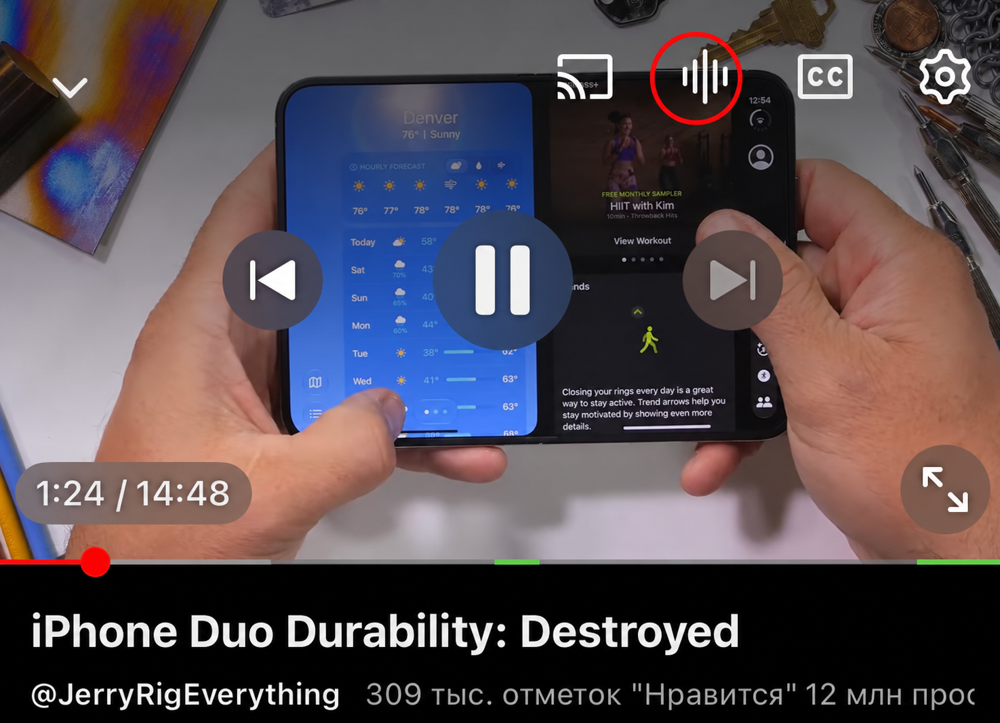
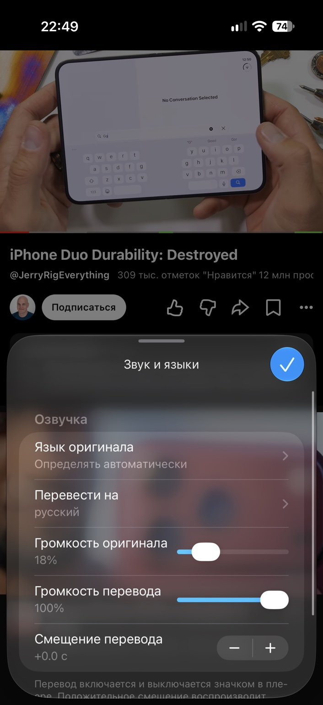
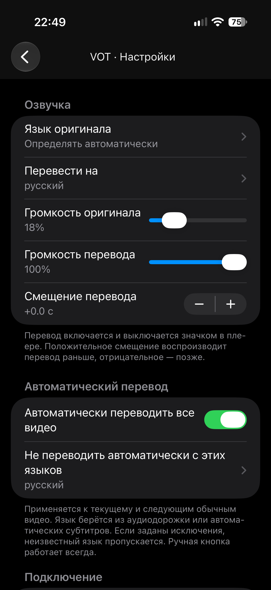
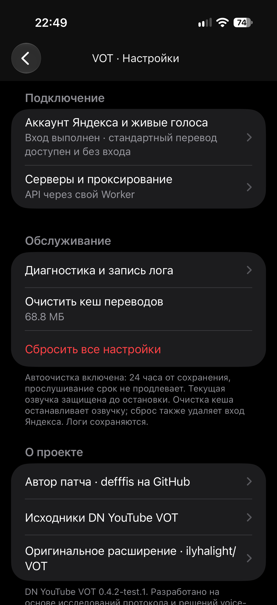

# DN YouTube Voice Translation

[Русский — основной язык](README.md) · **English**

A native patch for YouTube on iOS: Yandex VOT video voice-over translation,
synchronized audio, separate volume controls, automatic translation and custom VOT Workers.

**Current release: 0.4.2.** [Download](https://github.com/defffis/dn-youtube-vot/releases/latest)
· [Install](docs/INSTALL.en.md) · [Configure](docs/CONFIGURATION.en.md)
· [Troubleshoot player reloads](docs/TROUBLESHOOTING.en.md)

Version **0.4.2** is based on the user-tested 0.4.2-test.1 prerelease. The user
confirmed that it works well and provided screenshots of the controls and settings.
The executable behavior is unchanged; only version strings were updated.
[Button and loading indicator](docs/PLAYER_CONTROLS.en.md).

## Screenshots

The added translation button is circled in red. Tap to enable/disable translation;
press and hold for quick settings. The screenshots show the Russian interface.



<details>
<summary>Quick settings and full settings</summary>

<p>



</p>

</details>

## Features

- Translation button in the top player controls, with no persistent overlay over the feed.
- Gray/white outline icon, preparation spinner, download progress ring and tap to cancel.
- Source/target languages, original/translation volume and timing offset; hold for quick settings.
- Automatic translation after playback starts advancing steadily; source-language exclusions.
- Direct Yandex API, custom compatible API or modern/legacy VOT Worker; separate API/audio routes.
- Standard voice without sign-in; OAuth/PKCE with Keychain for requesting lively voices directly.
- Local audio, pause/seek synchronization, 0.5–2× playback; 128 MB cache with a 24-hour expiry.
- Diagnostics, JSONL event recording and export through the system share sheet.

## Compatibility and status

The adapter targets YouTube **21.40.5**, ARM64 and iOS 16+. Earlier user tests on
**iOS 27.0.1** confirmed audible translation, short PiP/background sessions,
automatic translation, language exclusions, caching and a modern Worker.
The user also confirmed that 0.4.2-test.1 works well. This is not a complete device matrix.
The cause of previously reported player reloads still requires comparison with the
same app without DNVOT. [Status, Russian](STATUS.md) · [Roadmap, Russian](ROADMAP.md).

Audio starts after preparation and a complete file download. Long videos may take
time. Live/Shorts, speeds outside 0.5–2×, prolonged background playback, all source
stream formats and compatibility with every third-party mod are not guaranteed.

## Quick start

1. Download `DNYouTubeVOT.dylib` from the current release.
2. Use your working YouTube IPA in GBox. Replace the previous DNVOT library and
   re-sign the app and embedded code. Keep one DNVOT copy; do not add the Probe.
3. Open YouTube → Settings → **VOT · Перевод видео** → **Настройки VOT**.
4. For the first test, use the direct API and standard voice without signing in.
5. Open a normal spoken video and tap the translation icon.

See the [installation guide](docs/INSTALL.en.md) for updates, Worker setup,
automatic translation, log export and conflict checks. These are English documents;
the patch's settings interface remains Russian.

## Build on Linux

```bash
python3 -m pip install protobuf==6.33.0
python3 tools/setup_toolchain.py
bash build.sh
bash test.sh
```

Use Ubuntu 24.04 x86_64 with Python, g++, dpkg-deb, tar/xz and access to the sources
pinned in [toolchain-lock.json](tools/toolchain-lock.json). The setup script verifies
LLVM/SDK hashes. No Mac is required. Output: `build/DNYouTubeVOT.dylib`.
The build is ad-hoc signed; your installation tool must re-sign embedded code.
A manual workflow is available in [.github/workflows/build.yml](.github/workflows/build.yml).
The project does not distribute an SDK, YouTube IPA, certificates or third-party mods.

## Sources and licenses

Developed from research into the protocol and approaches used by
[ilyhalight/voice-over-translation](https://github.com/ilyhalight/voice-over-translation)
and [vot.js](https://github.com/ilyhalight/vot.js). This is a separate native implementation.
Patch author: [defffis](https://github.com/defffis).

Project code is [MIT licensed](LICENSE); upstream notices are preserved in
[NOTICE.md](NOTICE.md) and `docs/LICENSE-*.txt`. The patch is not affiliated with
YouTube/Google or Yandex. [Architecture, Russian](docs/ANALYSIS.md)
· [Contributing](CONTRIBUTING.en.md) · [Privacy](SECURITY.en.md).
